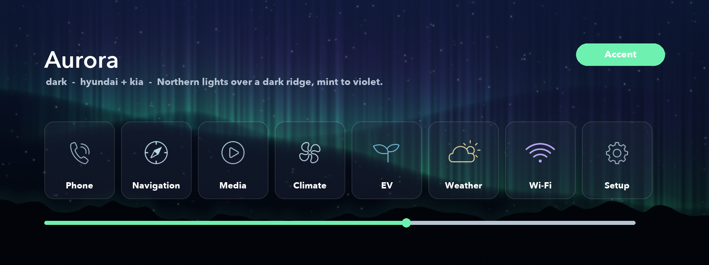
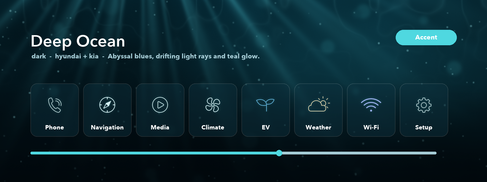
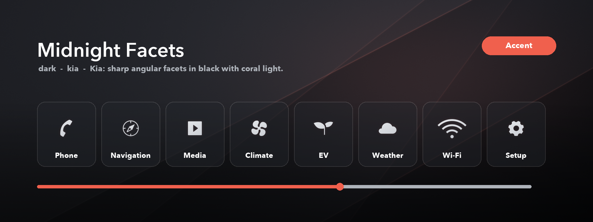
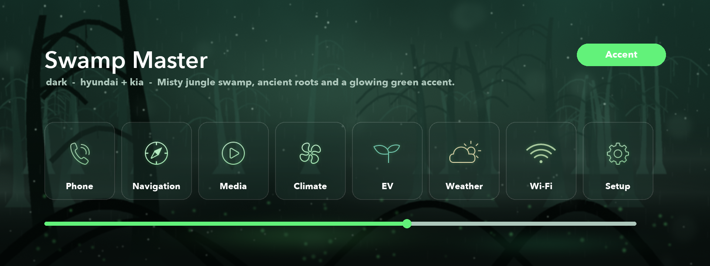

# ccNC Themes

**Themes for [ccNC for Gen5W](https://github.com/JacobPantuso/ccnc-gen5w): wallpapers, colours, icons and startup videos for Hyundai and Kia Gen5W head units.**

[Install](docs/INSTALLING.md) · [Catalog](docs/CATALOG.md) · [Make a theme](CONTRIBUTING.md) · [Theme format](docs/THEME-FORMAT.md) · [How the store works](docs/STORE.md)

---

> ☕ **Enjoying ccNC-Gen5W?** It's free and took a *lot* of late nights to build, and a fair amount of paid AI usage
> along the way. If you enjoy the experience, consider [donating](https://buymeacoffee.com/jacobpantuso). It helps keep updates and new features coming.

## Overview

A theme restyles every ccNC app at once: Home, Settings, Climate, Media, EV and the rest. Themes are installed
from the **Theme Store** inside ccNC whenever the head unit is on Wi-Fi, or from a USB stick. Anyone can make
one and submit it here; accepted themes appear in every car's store with the author's name.

## Catalog

<!-- catalog:start -->
13 themes. Details for each: [docs/CATALOG.md](docs/CATALOG.md).

<table>
<tr><td width="33%" align="center"> <b>Arctic Light</b></td><td width="33%" align="center"> <b>Aurora</b></td><td width="33%" align="center"> <b>Candy Cane Christmas</b></td></tr>
<tr><td width="33%" align="center"> <b>Carbon Orange</b></td><td width="33%" align="center"> <b>Deep Ocean</b></td><td width="33%" align="center"> <b>Evergreen</b></td></tr>
<tr><td width="33%" align="center"> <b>Parametric Blue</b></td><td width="33%" align="center"> <b>Midnight Facets</b></td><td width="33%" align="center"> <b>Neon Drive</b></td></tr>
<tr><td width="33%" align="center"> <b>Rose Gold</b></td><td width="33%" align="center"> <b>Sandstone</b></td><td width="33%" align="center"> <b>Swamp Master</b></td></tr>
<tr><td width="33%" align="center"> <b>Swamp Ogre</b></td></tr>
</table>
<!-- catalog:end -->

## Install a theme

1. Connect the head unit to Wi-Fi.
2. Open **Settings > Screen Theme > Theme Store** in ccNC, choose a theme and tap **Install**.
3. Choose it in **Settings > Screen Theme > ccNC Theme**.

No Wi-Fi? Install from a USB stick instead: see **[Installing themes](docs/INSTALLING.md)**.

## Make your own

Copy `tools/template`, set your colours, add a 1920 x 720 wallpaper and any icons, validate, and open a pull
request. The full walkthrough is in **[CONTRIBUTING.md](CONTRIBUTING.md)**; every field is described in
**[Theme format](docs/THEME-FORMAT.md)**.

## Documentation

| Guide | What's in it |
|---|---|
| [Installing themes](docs/INSTALLING.md) | Theme Store, USB stick, updating and removing |
| [Catalog](docs/CATALOG.md) | Every theme with its preview and details |
| [Contributing](CONTRIBUTING.md) | Making and submitting a theme, and the rules |
| [Theme format](docs/THEME-FORMAT.md) | `theme.json`, wallpaper, icons and videos |
| [How the store works](docs/STORE.md) | Signed releases, download checks, publishing |

## License

Tools: [MIT](LICENSE). Themes: [CC BY 4.0](packs/LICENSE.md), credit the theme's author.

**Starter pack:** the icons and fonts are Hyundai's proprietary artwork and fonts. All credit goes to Hyundai.
