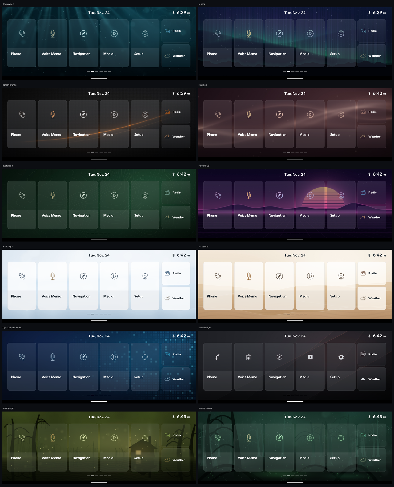
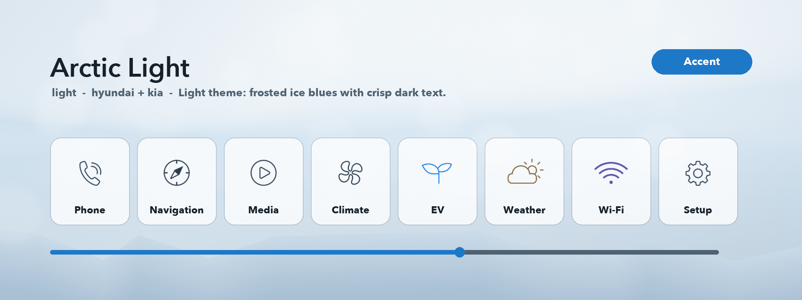
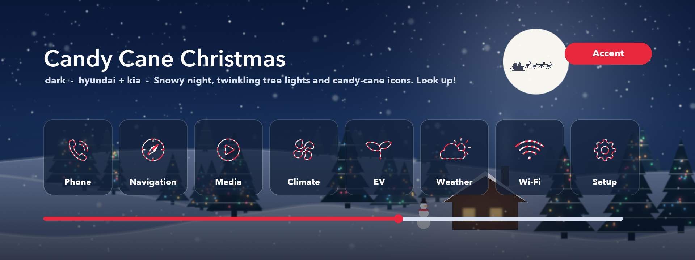
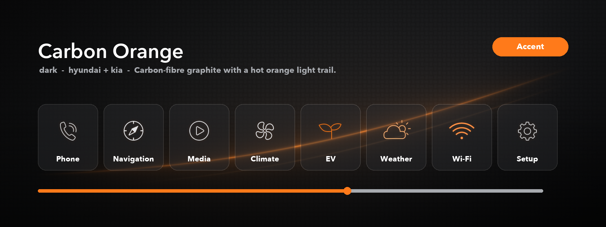
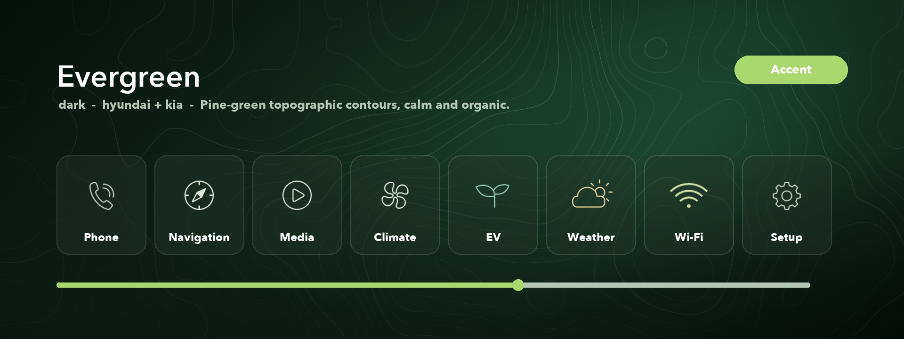
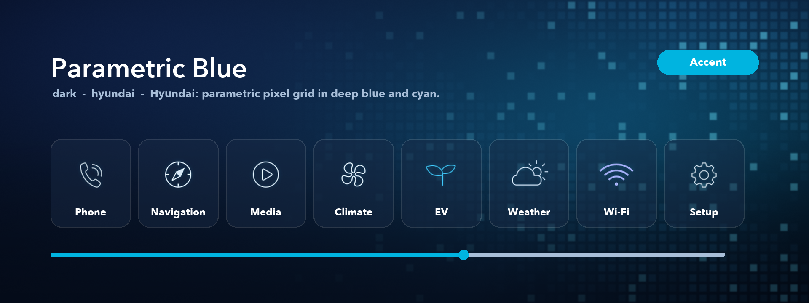
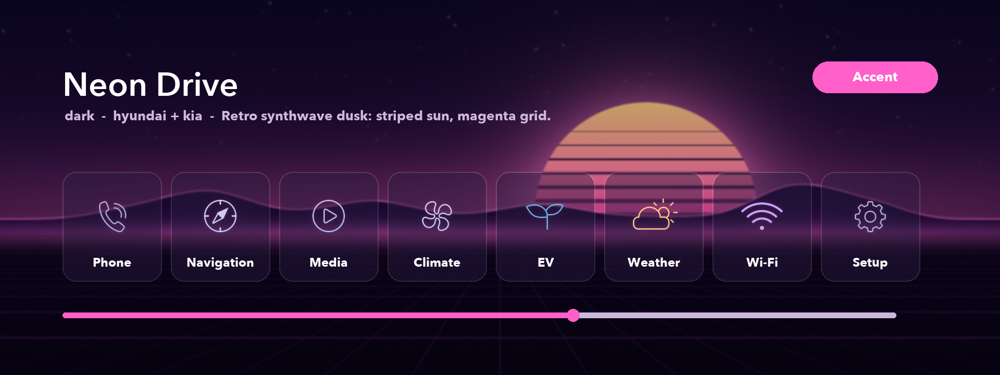
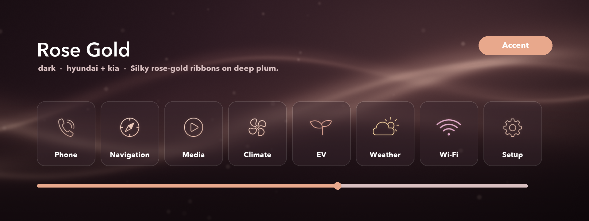
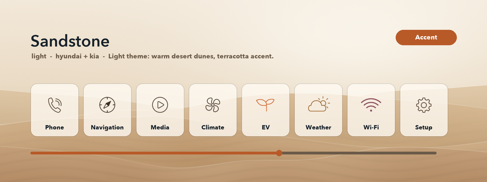
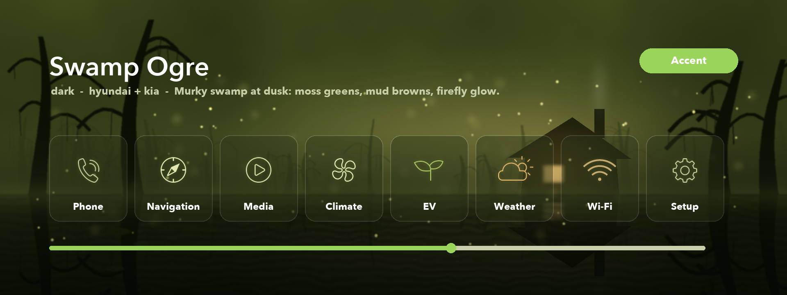

# ccNC Themes

Themes for [**ccNC for Gen5W**](https://github.com/JacobPantuso/ccnc-gen5w), the ccNC-style interface for
Hyundai and Kia Gen5W head units. A theme restyles every ccNC app at once: wallpaper, colours, icons, and
optionally the startup and shutdown videos.

## Install a theme

- **Over Wi-Fi (easiest):** in ccNC, open **Settings > Screen Theme > Theme Store**, tap a theme and
  **Install**. When the car joins Wi-Fi, ccNC tells you about new themes and updates. Nothing installs by itself.
- **From a USB stick:** download the theme's `ccnc.theme.<id>-<version>-nemesis.zip` from the
  [latest release](https://github.com/JacobPantuso/ccnc-themes/releases/latest), unzip it onto the root of a
  stick, and install it from NEMESIS Manager.

Then choose it in **Settings > Screen Theme > ccNC Theme**.

## Catalog

<!-- catalog:start -->
13 themes.

| Preview | Theme |
|---|---|
|  | **Arctic Light** `arctic-light` Light theme: frosted ice blues with crisp dark text. by ccNC Light · Hyundai + Kia · v1.0 Includes: startup video, icons |
|  | **Aurora** `aurora` Northern lights over a dark ridge, mint to violet. by ccNC Dark · Hyundai + Kia · v1.0 Includes: startup video, icons |
|  | **Candy Cane Christmas** `candy-cane-christmas` Snowy night, twinkling tree lights and candy-cane icons. Look up! by ccNC Dark · Hyundai + Kia · v1.0 Includes: startup video, icons |
|  | **Carbon Orange** `carbon-orange` Carbon-fibre graphite with a hot orange light trail. by ccNC Dark · Hyundai + Kia · v1.0 Includes: startup video, icons |
|  | **Deep Ocean** `deep-ocean` Abyssal blues, drifting light rays and teal glow. by ccNC Dark · Hyundai + Kia · v1.0 Includes: startup video, icons |
|  | **Evergreen** `evergreen` Pine-green topographic contours, calm and organic. by ccNC Dark · Hyundai + Kia · v1.0 Includes: startup video, icons |
|  | **Parametric Blue** `hyundai-parametric` Hyundai: parametric pixel grid in deep blue and cyan. by ccNC Dark · Hyundai · v1.0 Includes: startup video, icons |
|  | **Midnight Facets** `kia-midnight` Kia: sharp angular facets in black with coral light. by ccNC Dark · Kia · v1.0 Includes: startup video, icons |
|  | **Neon Drive** `neon-drive` Retro synthwave dusk: striped sun, magenta grid. by ccNC Dark · Hyundai + Kia · v1.0 Includes: startup video, icons |
|  | **Rose Gold** `rose-gold` Silky rose-gold ribbons on deep plum. by ccNC Dark · Hyundai + Kia · v1.0 Includes: startup video, icons |
|  | **Sandstone** `sandstone` Light theme: warm desert dunes, terracotta accent. by ccNC Light · Hyundai + Kia · v1.0 Includes: startup video, icons |
|  | **Swamp Master** `swamp-master` Misty jungle swamp, ancient roots and a glowing green accent. by ccNC Dark · Hyundai + Kia · v1.0 Includes: startup video, icons |
|  | **Swamp Ogre** `swamp-ogre` Murky swamp at dusk: moss greens, mud browns, firefly glow. by ccNC Dark · Hyundai + Kia · v1.0 Includes: startup video, icons |
<!-- catalog:end -->

## Make your own

Anyone can make a theme and send it in: see [CONTRIBUTING.md](CONTRIBUTING.md). Short version: copy
`tools/template` to `packs/<your-id>/`, edit `theme.json` (put your name in `author` and your GitHub username
in `github`, that's how you're credited in the store), add a 1920 x 720 wallpaper and any icons, check it with
`python3 -I tools/validate.py packs/<your-id>`, and open a pull request. An automatic check validates every
pull request.

## How the store works

Each release holds the theme list (`themes.json`), its signature, a preview and a zip for every theme. ccNC
only uses a list signed with the store's key, checks every download against it, and only unpacks a theme's own
files (theme.json, wallpaper, icons, videos), so nothing else can reach the car through a theme.

## Licence

Tools: MIT ([LICENSE](LICENSE)). Themes: CC BY 4.0, credit the theme's author; see
[packs/LICENSE.md](packs/LICENSE.md) (the starter packs' icons are recoloured ccNC artwork and not covered).
