# Theme catalog

[← Back to README](../README.md)

<!-- Generated by tools/catalog.py from packs/*/theme.json. Do not edit by hand. -->

14 themes. Install them from **Settings > Screen Theme > Theme Store** in ccNC.

| Theme | Style | Cars | Version | Author |
|---|---|---|---|---|
| [Arctic Light](#arctic-light) | Light | Hyundai + Kia | 1.0 | [Jacob Pantuso](https://github.com/JacobPantuso) |
| [Aurora](#aurora) | Dark | Hyundai + Kia | 1.0 | [Jacob Pantuso](https://github.com/JacobPantuso) |
| [Candy Cane Christmas](#candy-cane-christmas) | Dark | Hyundai + Kia | 1.0 | [Jacob Pantuso](https://github.com/JacobPantuso) |
| [Carbon Orange](#carbon-orange) | Dark | Hyundai + Kia | 1.0 | [Jacob Pantuso](https://github.com/JacobPantuso) |
| [Catppuccin Mocha](#catppuccin-mocha) | Dark | Hyundai + Kia | 1.0 | [Colby Roark](https://github.com/ColbyRoark) |
| [Deep Ocean](#deep-ocean) | Dark | Hyundai + Kia | 1.0 | [Jacob Pantuso](https://github.com/JacobPantuso) |
| [Evergreen](#evergreen) | Dark | Hyundai + Kia | 1.0 | [Jacob Pantuso](https://github.com/JacobPantuso) |
| [Parametric Blue](#hyundai-parametric) | Dark | Hyundai | 1.0 | [Jacob Pantuso](https://github.com/JacobPantuso) |
| [Midnight Facets](#kia-midnight) | Dark | Kia | 1.0 | [Jacob Pantuso](https://github.com/JacobPantuso) |
| [Neon Drive](#neon-drive) | Dark | Hyundai + Kia | 1.0 | [Jacob Pantuso](https://github.com/JacobPantuso) |
| [Rose Gold](#rose-gold) | Dark | Hyundai + Kia | 1.0 | [Jacob Pantuso](https://github.com/JacobPantuso) |
| [Sandstone](#sandstone) | Light | Hyundai + Kia | 1.0 | [Jacob Pantuso](https://github.com/JacobPantuso) |
| [Swamp Master](#swamp-master) | Dark | Hyundai + Kia | 1.0 | [Jacob Pantuso](https://github.com/JacobPantuso) |
| [Swamp Ogre](#swamp-ogre) | Dark | Hyundai + Kia | 1.0 | [Jacob Pantuso](https://github.com/JacobPantuso) |

## Arctic Light

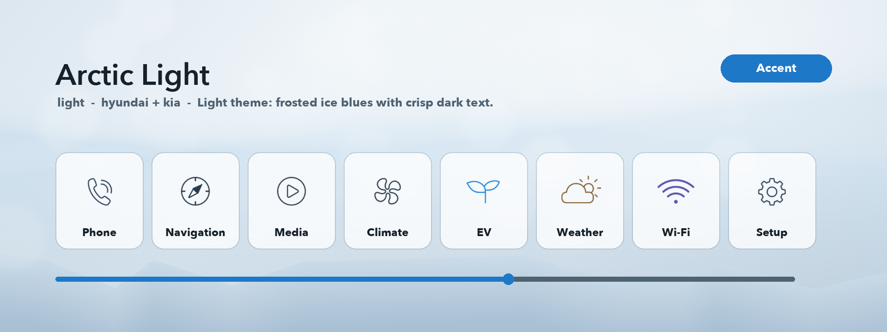

> Light theme: frosted ice blues with crisp dark text.

| | |
|---|---|
| ID | `arctic-light` |
| Style | Light |
| Cars | Hyundai + Kia |
| Version | 1.0 |
| Author | [Jacob Pantuso](https://github.com/JacobPantuso) |
| Includes | startup video, custom icons |
| Files | [packs/arctic-light](../packs/arctic-light) |

## Aurora

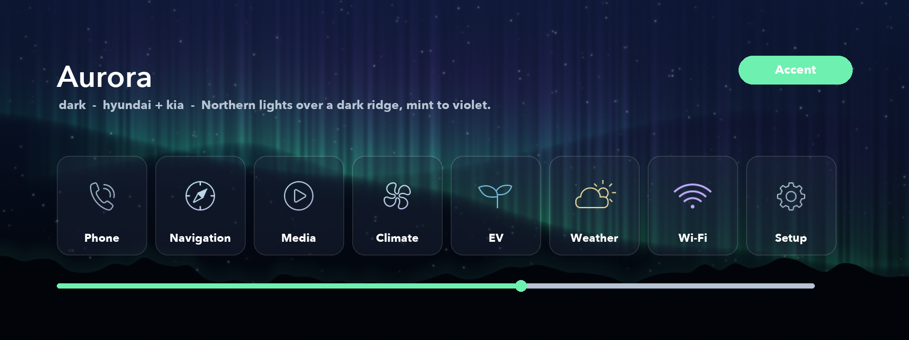

> Northern lights over a dark ridge, mint to violet.

| | |
|---|---|
| ID | `aurora` |
| Style | Dark |
| Cars | Hyundai + Kia |
| Version | 1.0 |
| Author | [Jacob Pantuso](https://github.com/JacobPantuso) |
| Includes | startup video, custom icons |
| Files | [packs/aurora](../packs/aurora) |

## Candy Cane Christmas

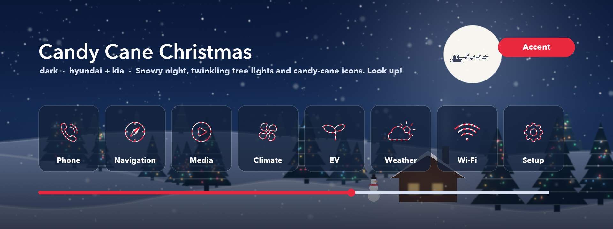

> Snowy night, twinkling tree lights and candy-cane icons. Look up!

| | |
|---|---|
| ID | `candy-cane-christmas` |
| Style | Dark |
| Cars | Hyundai + Kia |
| Version | 1.0 |
| Author | [Jacob Pantuso](https://github.com/JacobPantuso) |
| Includes | startup video, custom icons |
| Files | [packs/candy-cane-christmas](../packs/candy-cane-christmas) |

## Carbon Orange

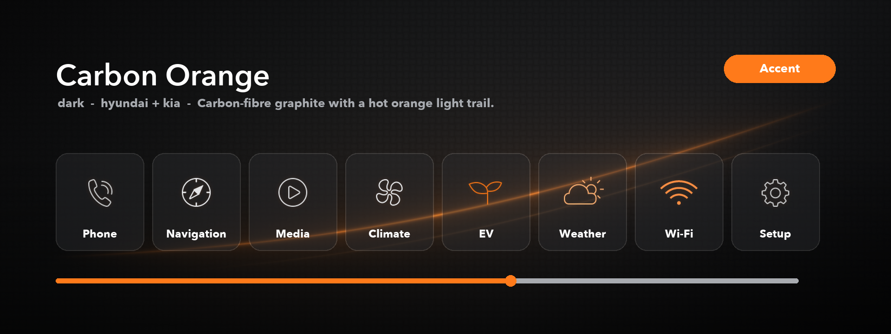

> Carbon-fibre graphite with a hot orange light trail.

| | |
|---|---|
| ID | `carbon-orange` |
| Style | Dark |
| Cars | Hyundai + Kia |
| Version | 1.0 |
| Author | [Jacob Pantuso](https://github.com/JacobPantuso) |
| Includes | startup video, custom icons |
| Files | [packs/carbon-orange](../packs/carbon-orange) |

## Catppuccin Mocha

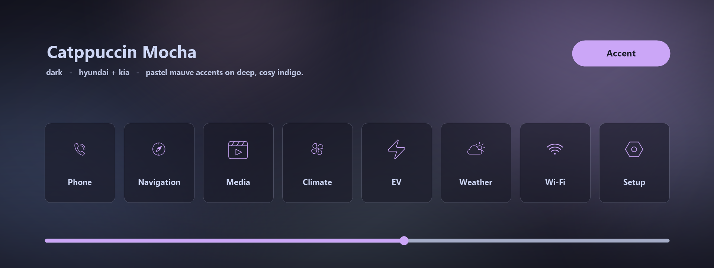

> Catppuccin Mocha: pastel mauve accents on deep, cosy indigo.

| | |
|---|---|
| ID | `catppuccin-mocha` |
| Style | Dark |
| Cars | Hyundai + Kia |
| Version | 1.0 |
| Author | [Colby Roark](https://github.com/ColbyRoark) |
| Includes | custom icons |
| Files | [packs/catppuccin-mocha](../packs/catppuccin-mocha) |

## Deep Ocean

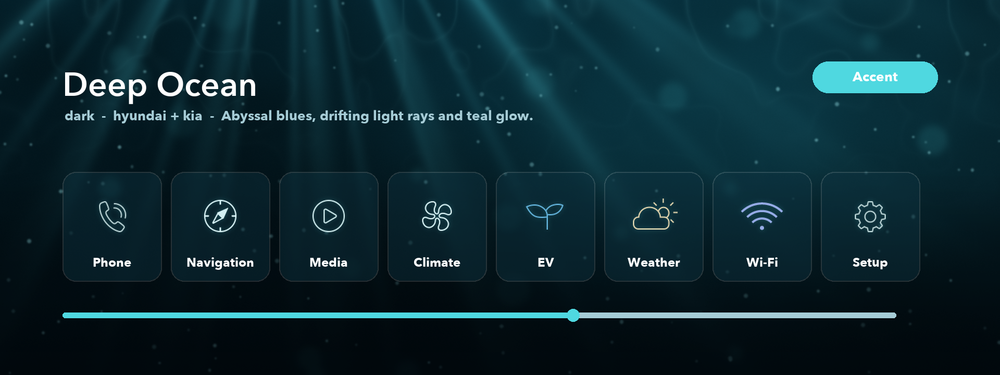

> Abyssal blues, drifting light rays and teal glow.

| | |
|---|---|
| ID | `deep-ocean` |
| Style | Dark |
| Cars | Hyundai + Kia |
| Version | 1.0 |
| Author | [Jacob Pantuso](https://github.com/JacobPantuso) |
| Includes | startup video, custom icons |
| Files | [packs/deep-ocean](../packs/deep-ocean) |

## Evergreen

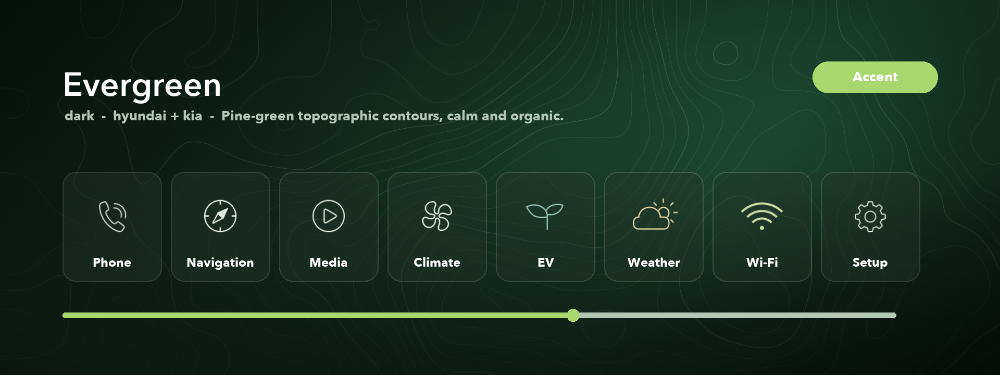

> Pine-green topographic contours, calm and organic.

| | |
|---|---|
| ID | `evergreen` |
| Style | Dark |
| Cars | Hyundai + Kia |
| Version | 1.0 |
| Author | [Jacob Pantuso](https://github.com/JacobPantuso) |
| Includes | startup video, custom icons |
| Files | [packs/evergreen](../packs/evergreen) |

## Parametric Blue

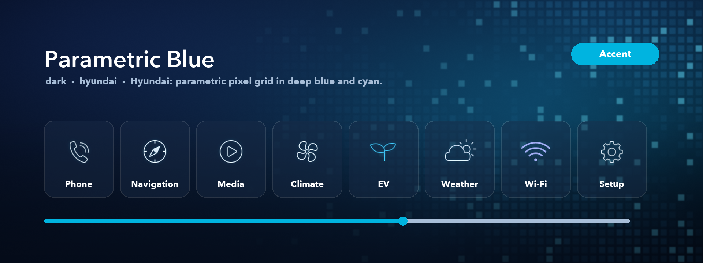

> Hyundai: parametric pixel grid in deep blue and cyan.

| | |
|---|---|
| ID | `hyundai-parametric` |
| Style | Dark |
| Cars | Hyundai |
| Version | 1.0 |
| Author | [Jacob Pantuso](https://github.com/JacobPantuso) |
| Includes | startup video, custom icons |
| Files | [packs/hyundai-parametric](../packs/hyundai-parametric) |

## Midnight Facets

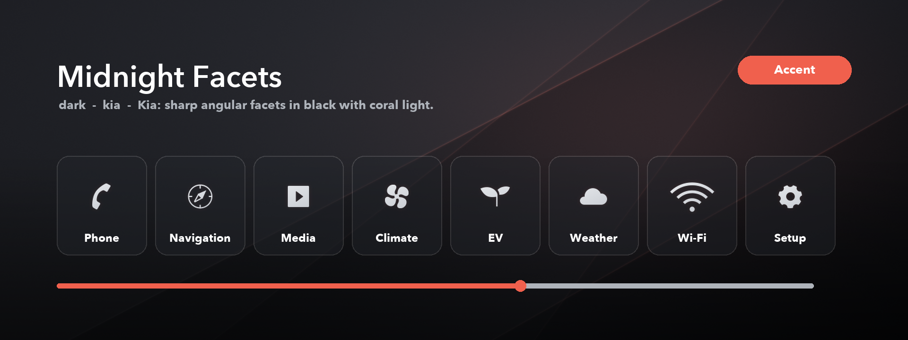

> Kia: sharp angular facets in black with coral light.

| | |
|---|---|
| ID | `kia-midnight` |
| Style | Dark |
| Cars | Kia |
| Version | 1.0 |
| Author | [Jacob Pantuso](https://github.com/JacobPantuso) |
| Includes | startup video, custom icons |
| Files | [packs/kia-midnight](../packs/kia-midnight) |

## Neon Drive

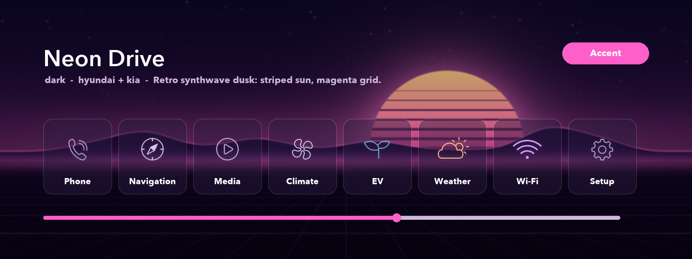

> Retro synthwave dusk: striped sun, magenta grid.

| | |
|---|---|
| ID | `neon-drive` |
| Style | Dark |
| Cars | Hyundai + Kia |
| Version | 1.0 |
| Author | [Jacob Pantuso](https://github.com/JacobPantuso) |
| Includes | startup video, custom icons |
| Files | [packs/neon-drive](../packs/neon-drive) |

## Rose Gold

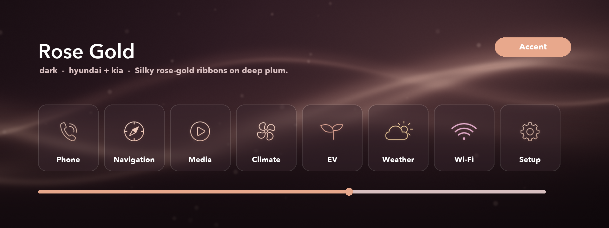

> Silky rose-gold ribbons on deep plum.

| | |
|---|---|
| ID | `rose-gold` |
| Style | Dark |
| Cars | Hyundai + Kia |
| Version | 1.0 |
| Author | [Jacob Pantuso](https://github.com/JacobPantuso) |
| Includes | startup video, custom icons |
| Files | [packs/rose-gold](../packs/rose-gold) |

## Sandstone

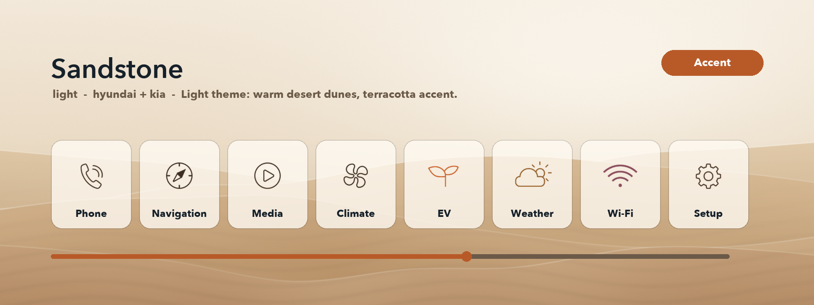

> Light theme: warm desert dunes, terracotta accent.

| | |
|---|---|
| ID | `sandstone` |
| Style | Light |
| Cars | Hyundai + Kia |
| Version | 1.0 |
| Author | [Jacob Pantuso](https://github.com/JacobPantuso) |
| Includes | startup video, custom icons |
| Files | [packs/sandstone](../packs/sandstone) |

## Swamp Master

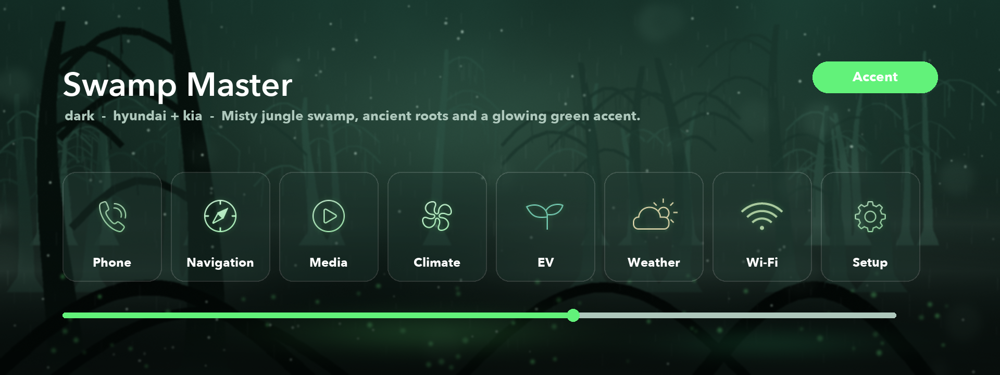

> Misty jungle swamp, ancient roots and a glowing green accent.

| | |
|---|---|
| ID | `swamp-master` |
| Style | Dark |
| Cars | Hyundai + Kia |
| Version | 1.0 |
| Author | [Jacob Pantuso](https://github.com/JacobPantuso) |
| Includes | startup video, custom icons |
| Files | [packs/swamp-master](../packs/swamp-master) |

## Swamp Ogre

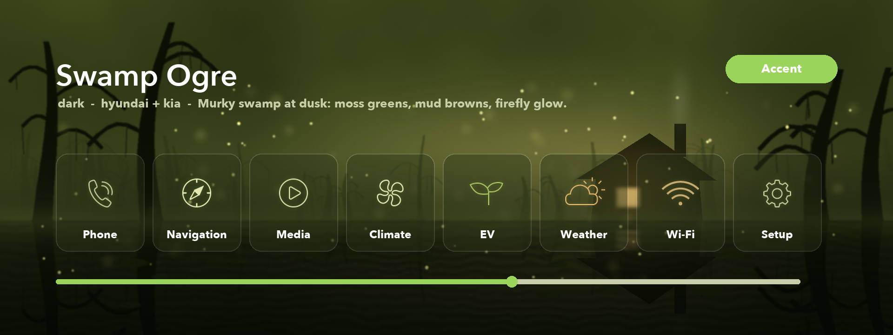

> Murky swamp at dusk: moss greens, mud browns, firefly glow.

| | |
|---|---|
| ID | `swamp-ogre` |
| Style | Dark |
| Cars | Hyundai + Kia |
| Version | 1.0 |
| Author | [Jacob Pantuso](https://github.com/JacobPantuso) |
| Includes | startup video, custom icons |
| Files | [packs/swamp-ogre](../packs/swamp-ogre) |
